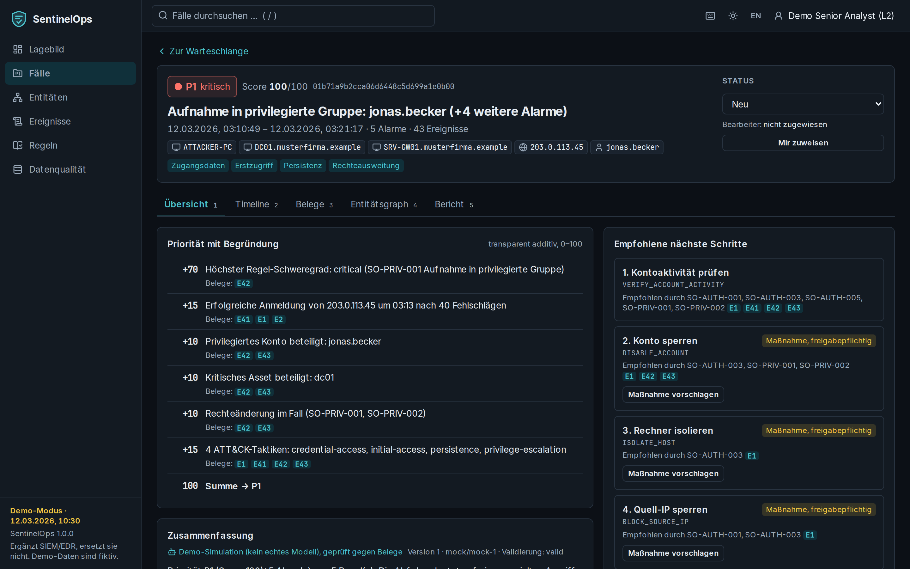
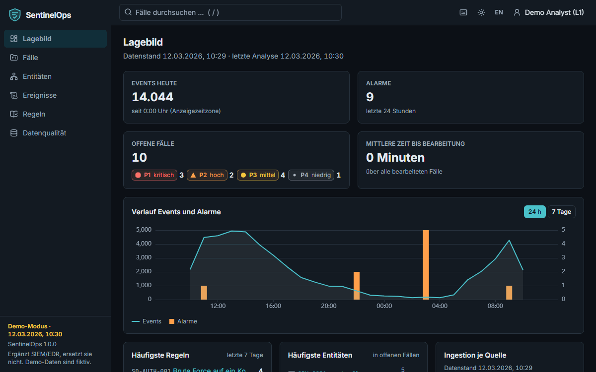
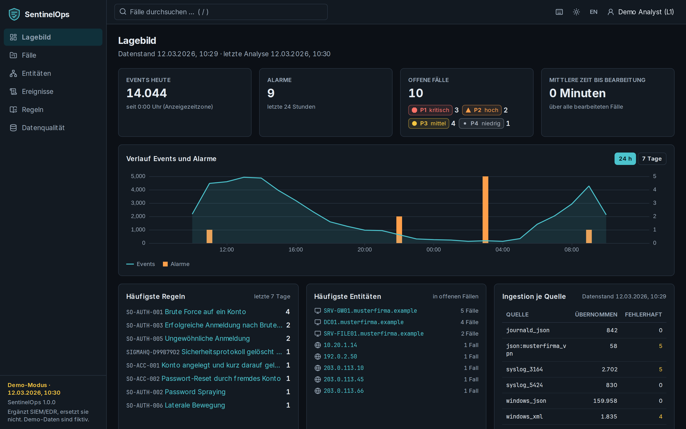
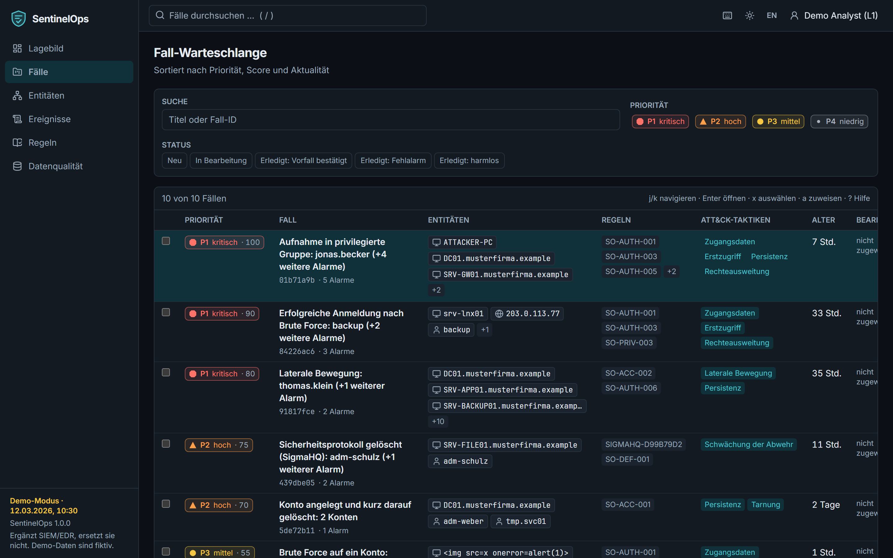
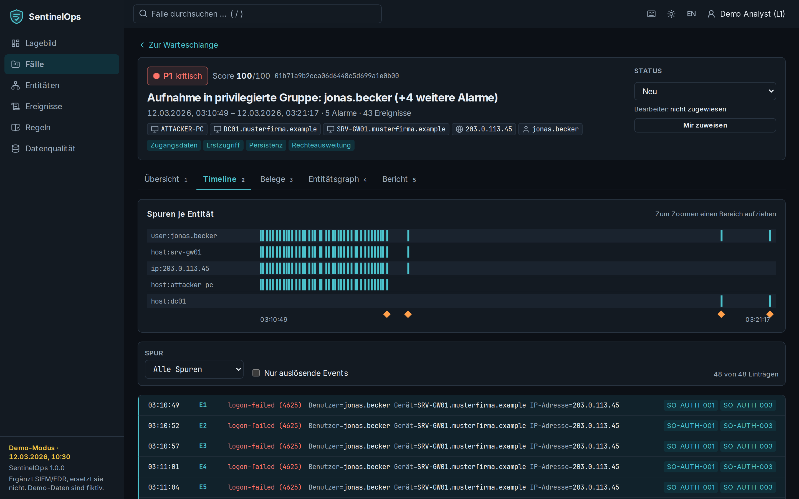
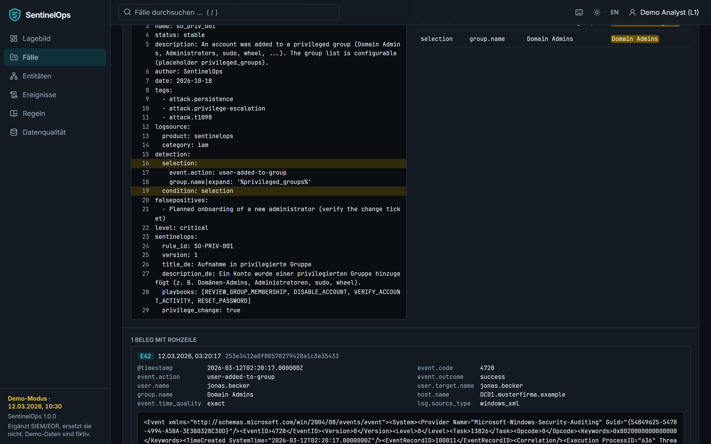
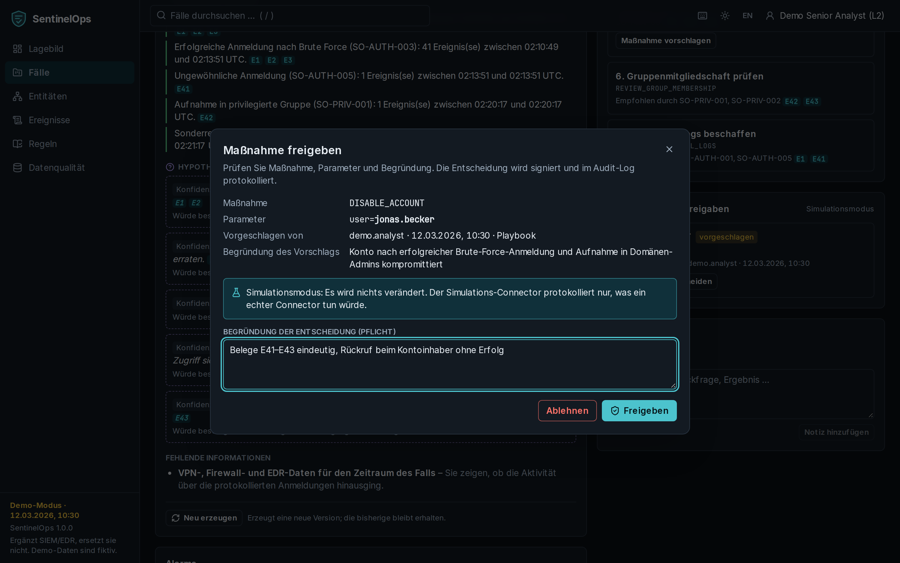
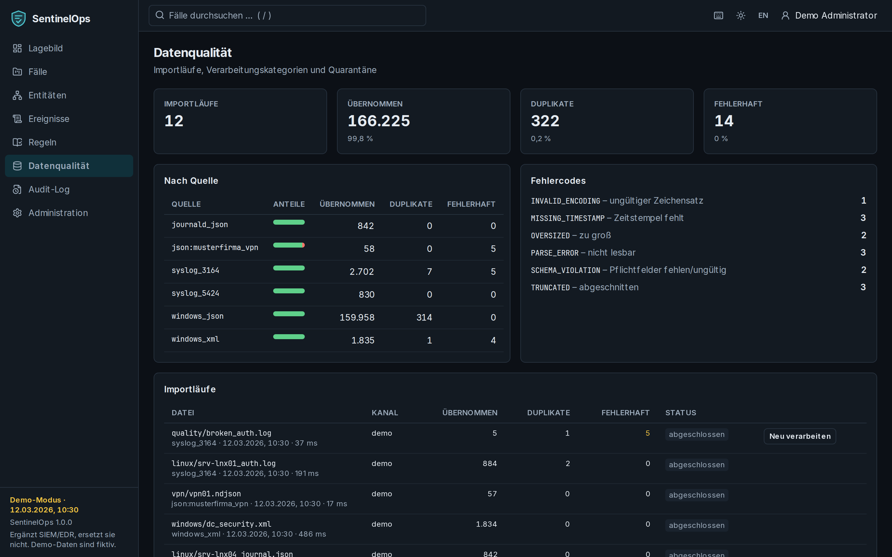
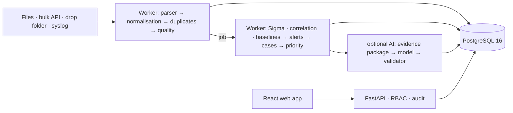

<p align="center">
  
</p>

<h1 align="center">SentinelOps</h1>

<p align="center"><strong>Explainable, AI-assisted security operations: from 50,000 log lines to an investigable case</strong></p>

<p align="center"><a href="README.md">Deutsch</a> · <b>English</b> · <a href="https://NOGtechnologia.github.io/sentinelops/">Documentation (German)</a> · <a href="docs/tour.md">Guided tour (German)</a></p>

<p align="center">
  <a href="https://github.com/NOGtechnologia/sentinelops/actions/workflows/ci.yml"></a>
  <a href="https://github.com/NOGtechnologia/sentinelops/actions/workflows/codeql.yml"></a>
  <a href="https://scorecard.dev/viewer/?uri=github.com/NOGtechnologia/sentinelops"></a>
  <a href="LICENSE"></a>
  <a href="https://github.com/NOGtechnologia/sentinelops/releases"></a>
</p>

<picture>
  <source media="(prefers-color-scheme: dark)" srcset="docs/images/case-overview-dark.png">
  <source media="(prefers-color-scheme: light)" srcset="docs/images/case-overview-light.png">
  
</picture>

<p align="center">
  
</p>

> The user interface is available in **German and English** (switch with `EN`/`DE` in the top bar).
> The screenshots show the German default; the detailed documentation is written in German.

## Why SentinelOps?

- **Rules before AI.** Detection is deterministic: Sigma, correlation and baseline rules. An AI only
  summarises the finished case afterwards – it never decides.
- **Every statement has evidence.** Priority factors, facts and hypotheses point to numbered raw log
  lines; a validator removes anything unsupported, including invented IPs, hashes or accounts.
- **Humans decide.** Response actions are proposals; only a senior analyst can approve them, signed,
  optionally with the four-eyes principle, and in version 1 they are only simulated.
- **Reproducible.** Same data, rules and configuration ⇒ identical cases and byte-identical reports.
- **Self-hosted and offline-capable.** Docker Compose, PostgreSQL, optional local model (Ollama); no
  telemetry, no external resources loaded in the browser.

## What it does

1. **Ingest** Windows EVTX/XML/JSON, Syslog (RFC 3164/5424), journald and JSON with mapping profiles –
   via upload, bulk API, drop folder or syslog receiver. Duplicates and malformed records are
   detected and quarantined with an error code.
2. **Detect** with 13 own rules (brute force, password spraying, success after brute force, unusual
   logon, lateral movement, privilege escalation, short-lived accounts, log clearing, …) plus 3 curated
   SigmaHQ rules – every rule ships with positive and negative tests.
3. **Build cases**: related alerts (shared users, hosts, IPs) become **one** case, with hub
   suppression so that a central server does not merge everything.
4. **Explain the priority** as a transparent sum of factors, each backed by evidence.
5. **Investigate** with a per-entity timeline, the rule YAML with the matching condition
   highlighted, the matching fields and the untouched raw line, and an entity graph.
6. **Respond** with playbook-based next steps; actions need human approval and are fully audited.
7. **Report** as Markdown, PDF or JSON, optionally pseudonymised; every export is logged.

| | |
|---|---|
|  **Dashboard** – metrics with time range and data freshness, trends, top rules and entities, ingestion health. |  **Case queue** – priority as colour, symbol and text, entities, rules, ATT&CK, keyboard navigation, bulk actions. |
|  **Timeline** – one lane per entity, triggering events marked, zoom, virtualised. |  **Evidence** – Sigma YAML with the condition highlighted, matching fields, raw lines. |
|  **Approve an action** – parameters, reason, simulation notice, four-eyes principle. |  **Data quality** – accepted/duplicate/malformed per source, error codes, quarantine. |

## Quick start (demo)

```bash
git clone https://github.com/NOGtechnologia/sentinelops.git && cd sentinelops
cp .env.example .env
docker compose -f deploy/docker-compose.yml --env-file .env up -d --build
```

Open <http://localhost:8080> and choose a **demo account** (e.g. "Demo Analyst (L1)"). Demo accounts
exist **only in demo mode** and are labelled as such; on first start the stack loads the fictitious
data of "Musterfirma GmbH" (takes a few minutes). For production set `SENTINELOPS_DEMO_MODE=false`,
configure OIDC and secrets – see [operations](docs/operations.md).

## Architecture



Python 3.12 · FastAPI · SQLAlchemy · PostgreSQL 16 · pySigma · React 19 · TypeScript · TanStack ·
Apache ECharts · Cytoscape.js · Playwright.

## Quality

Everything is checked automatically (`make check`): ruff, mypy `--strict`, import-linter
architecture contracts, Sigma validation, unit/property/integration/contract (Schemathesis)/acceptance
tests, ≥ 90 % backend coverage with 100 % lines and branches in the core modules, Playwright E2E with
axe accessibility and an XSS suite fed with hostile log data, gitleaks, Semgrep, pip-audit, CodeQL,
OWASP ZAP, Trivy and SBOM/cosign for releases.

Detection benchmark on a holdout dataset never used for tuning: recall 1.00 per scenario, precision
1.00 per rule, every scenario in exactly one case, zero cases on pure normal behaviour. All eight
acceptance tests (A1–A8) pass – see [progress and acceptance](docs/progress.md).

## Security and privacy

Log data is always rendered as text, never as HTML; strict CSP; permissions per API route; ingest
tokens separate from user logins; append-only audit log with a hash chain; containers run as non-root
with a read-only file system. See [SECURITY.md](SECURITY.md).

> **Privacy and co-determination:** security logs contain personal data of employees. Operators must
> clarify the legal basis, purpose limitation and retention periods (GDPR); in Germany, the works
> council usually has a say in technical systems that are suitable for monitoring behaviour or
> performance (§ 87(1) no. 6 BetrVG). Details with sources in [docs/privacy.md](docs/privacy.md)
> (German) – not legal advice.

## Contributing

Contributions are welcome – especially new detection rules with tests. See
[CONTRIBUTING.md](CONTRIBUTING.md) and the [code of conduct](CODE_OF_CONDUCT.md). Please report false
positives with the "false positive" issue form – without real company data.

## License and acknowledgements

Code: [Apache-2.0](LICENSE). Curated rules from [SigmaHQ](https://github.com/SigmaHQ/sigma) are under
the Detection Rule License 1.1 (authors in [NOTICE](NOTICE)). Thanks to pySigma, evtx, FastAPI,
SQLAlchemy, PostgreSQL, React, TanStack, Apache ECharts, Cytoscape.js, Playwright and many more – see
[docs/data-sources.md](docs/data-sources.md).

## Disclaimer

SentinelOps is **not a replacement for a SIEM or EDR**; it complements them when investigating
incidents. All demo data (Musterfirma GmbH, `musterfirma.example`, RFC 5737 addresses) is fictitious.
The software is provided without warranty; the privacy and labour-law notes are not legal advice.
