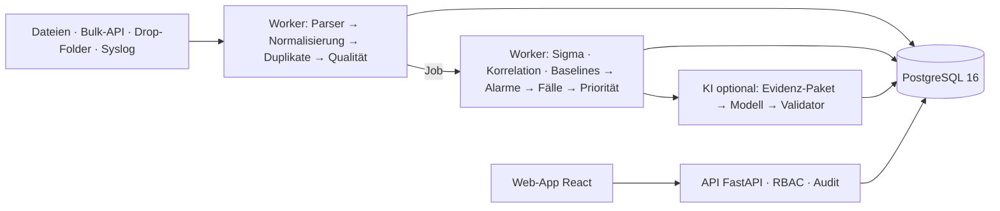

<p align="center">
  
</p>

<h1 align="center">SentinelOps</h1>

<p align="center"><strong>Erklärbares, KI-gestütztes Security-Operations-Werkzeug: von 50.000 Log-Zeilen zum untersuchbaren Fall</strong></p>

<p align="center">
  <a href="https://github.com/OWNER/sentinelops/actions/workflows/ci.yml"></a>
  <a href="https://github.com/OWNER/sentinelops/actions/workflows/ci.yml"></a>
  <a href="https://github.com/OWNER/sentinelops/actions/workflows/codeql.yml"></a>
  <a href="https://scorecard.dev/viewer/?uri=github.com/OWNER/sentinelops"></a>
  <a href="LICENSE"></a>
  <a href="https://github.com/OWNER/sentinelops/releases"></a>
  <a href="https://github.com/OWNER/sentinelops/pkgs/container/sentinelops"></a>
</p>

<picture>
  <source media="(prefers-color-scheme: dark)" srcset="docs/images/case-overview-dark.png">
  <source media="(prefers-color-scheme: light)" srcset="docs/images/case-overview-light.png">
  
</picture>

<p align="center">
  
</p>

## Warum SentinelOps?

- **Regeln vor KI.** Erkennung deterministisch mit Sigma-, Korrelations- und Baseline-Regeln. Die KI
  fasst erst danach zusammen – und entscheidet nie.
- **Jede Aussage hat Belege.** Prioritäten, Fakten und Hypothesen verweisen auf nummerierte Rohzeilen;
  ein Validator verwirft alles Unbelegte, inklusive erfundener IPs, Hashes oder Konten.
- **Der Mensch entscheidet.** Maßnahmen sind Vorschläge; Freigabe nur durch L2, signiert,
  Vier-Augen-Prinzip, in V1 ausschließlich simuliert.
- **Reproduzierbar.** Gleiche Daten, Regeln und Konfiguration ⇒ identische Fälle und byte-identische
  Berichte.
- **Selbst hostbar und offline-fähig.** Docker Compose, PostgreSQL, optional lokales Modell (Ollama);
  keine Telemetrie, keine externen Ressourcen im Browser.

## Funktionen

| | |
|---|---|
|  **Lagebild** – Kennzahlen mit Zeitraum und Datenstand, Verlauf, häufigste Regeln und Entitäten, Ingestion je Quelle. |  **Fall-Warteschlange** – Priorität (Farbe, Symbol, Text), Entitäten, Regeln, ATT&CK, Tastatursteuerung, Massenaktionen. |
|  **Timeline** – Spuren je Entität, Auslöser markiert, Zeitlücken und Zeitqualität, Zoom, virtualisiert. |  **Belege** – Sigma-YAML mit hervorgehobener Bedingung, passende Felder, unveränderte Rohzeilen. |
|  **Maßnahme freigeben** – Parameter, Begründung, Simulationshinweis, Vier-Augen-Prinzip. |  **Datenqualität** – übernommen/Duplikat/fehlerhaft je Quelle, Fehlercodes, Quarantäne. |

Außerdem: Ingestion von Windows EVTX/XML/JSON, Syslog (RFC 3164/5424), journald und JSON mit
Mapping-Profilen über Upload, Bulk-API, Drop-Folder und Syslog-Empfänger · Duplikaterkennung ·
Fallbildung mit Hub-Unterdrückung · Entitätsgraph · Ereignissuche mit CSV-Export · Berichte als
Markdown, PDF und JSON (optional pseudonymisiert) · Audit-Log mit Hash-Kette · DE/EN, dunkel/hell.

## Schnellstart (Demo)

```bash
git clone https://github.com/OWNER/sentinelops.git && cd sentinelops
cp .env.example .env
docker compose -f deploy/docker-compose.yml --env-file .env up -d --build
```

Dann <http://localhost:8080> öffnen und einen **Demo-Zugang** wählen (z. B. „Demo Analyst (L1)“).
Demo-Zugänge sind **nur im Demo-Modus** aktiv und als solche gekennzeichnet; der Stack lädt beim
ersten Start die fiktiven Daten der Musterfirma GmbH (einige Minuten). Für den Produktivbetrieb:
`SENTINELOPS_DEMO_MODE=false`, OIDC und Secrets setzen – siehe [Betrieb](docs/operations.md).

## Architektur



Details: [Architektur](docs/architecture.md) · [Schema](docs/schema.md) · [ADRs](docs/adr/index.md)

## Erkennung und KI

- [Erkennungskatalog](docs/detection-catalog.md) – 13 eigene Regeln (Brute Force, Password Spraying,
  Erfolg nach Brute Force, ungewöhnliche Anmeldung, laterale Bewegung, Rechteausweitung, kurzlebige
  Konten, Protokolllöschung, …) und 3 kuratierte SigmaHQ-Regeln, jede mit Tests.
- [KI-Prinzipien](docs/ai.md) – Fakten und Hypothesen getrennt, fehlende Informationen benannt,
  Validator gegen unbelegte Aussagen, Prompt-Injection-Erkennung, Pseudonymisierung für Cloud-Modelle.
  Ohne KI liefert SentinelOps eine deterministische Vorlagen-Zusammenfassung.

## Sicherheit und Datenschutz

Logdaten werden immer als Text dargestellt, nie als HTML; strikte CSP; Rollen je API-Route;
Ingest-Tokens getrennt von Benutzer-Logins; Audit-Log append-only mit Hash-Kette; Container ohne
Root-Rechte mit schreibgeschütztem Dateisystem. Siehe [Bedrohungsmodell](docs/threat-model.md),
[ASVS-Checkliste](docs/security/asvs.md) und [SECURITY.md](SECURITY.md).

> **Datenschutz und Mitbestimmung:** Sicherheitsprotokolle enthalten personenbezogene Daten von
> Beschäftigten. Betreiber müssen u. a. Rechtsgrundlage, Zweckbindung und Aufbewahrungsfristen klären
> (DSGVO); in Deutschland ist bei technischen Einrichtungen, die zur Verhaltens- oder
> Leistungskontrolle geeignet sind, in der Regel der **Betriebsrat** zu beteiligen
> (§ 87 Abs. 1 Nr. 6 BetrVG). Hinweise mit Quellen: [docs/privacy.md](docs/privacy.md) – keine Rechtsberatung.

## Abnahmetests Version 1

| ID | Abnahmetest | Automatisierter Nachweis | Status |
|---|---|---|---|
| A1 | Viele fehlgeschlagene Logins werden gruppiert | `test_a1_failed_logins_grouped` | ✅ |
| A2 | Normale, verdächtige und fehlerhafte Logs richtig eingeordnet | `test_a2_processing_categories` | ✅ |
| A3 | Doppelte Events ändern keine Zählungen | `test_a3_duplicates_no_double_count` | ✅ |
| A4 | Fehlalarm: Regel und Evidenz prüfbar, markieren, Ausnahme, Audit | `e2e/a4_false_positive.spec.ts` | ✅ |
| A5 | Berichte reproduzierbar | `test_a5_report_reproducible` | ✅ |
| A6 | KI erfindet keine Indikatoren | `test_a6_ai_grounding` | ✅ |
| A7 | Keine Maßnahme ohne Freigabe | `test_a7_no_action_without_approval` + `e2e/a7_approval.spec.ts` | ✅ |
| A8 | Ohne KI nutzbar | `test_a8_works_without_llm` | ✅ |

Benchmark auf dem Holdout-Datensatz (nie zum Abstimmen verwendet): Recall 1,00 je Szenario,
Precision 1,00 je Regel, jedes Szenario in genau einem Fall, 0 Fälle auf reinem Normalverhalten.
Stand und Details: [Fortschritt und Abnahme](docs/progress.md).

## Roadmap

- Echte Response-Connectoren (Verzeichnisdienst, EDR, Firewall) hinter derselben Freigabe-Schnittstelle
- Weitere Quellen (Firewall, Proxy, Cloud-Audit-Logs) über Mapping-Profile
- Optionale Geolokalisierung mit lokal eingebundener Datenbank
- Mandantenfähigkeit

## Mitwirken

Beiträge sind willkommen – besonders neue Erkennungsregeln mit Tests. Siehe
[CONTRIBUTING.md](CONTRIBUTING.md) und den [Verhaltenskodex](CODE_OF_CONDUCT.md). Fehlalarme bitte über
das Issue-Formular „Fehlalarm melden“ – ohne echte Unternehmensdaten.

## Lizenz und Danksagung

Code: [Apache-2.0](LICENSE). Kuratierte Regeln aus [SigmaHQ](https://github.com/SigmaHQ/sigma) stehen
unter der Detection Rule License 1.1 (Autoren in [NOTICE](NOTICE)). Dank an die Projekte pySigma,
evtx, FastAPI, SQLAlchemy, PostgreSQL, React, TanStack, Apache ECharts, Cytoscape.js, Playwright und
viele weitere – vollständige Liste in [docs/data-sources.md](docs/data-sources.md).

## Haftungsausschluss

SentinelOps ist **kein Ersatz für ein SIEM oder EDR**, sondern ergänzt sie bei der Untersuchung von
Vorfällen. Alle Demo-Daten (Musterfirma GmbH, `musterfirma.example`, Adressen aus RFC 5737) sind
fiktiv. Die Software wird ohne Gewähr bereitgestellt; Datenschutz- und Arbeitsrechtshinweise sind
keine Rechtsberatung.

---

**English summary:** SentinelOps turns raw Windows, Linux and JSON security logs into explainable,
evidence-backed cases: deterministic Sigma/correlation detection first, an optional AI summary that is
validated against the evidence, and human approval for every response action. Self-hosted with Docker
Compose; UI in German and English. See the [documentation](docs/index.md).
