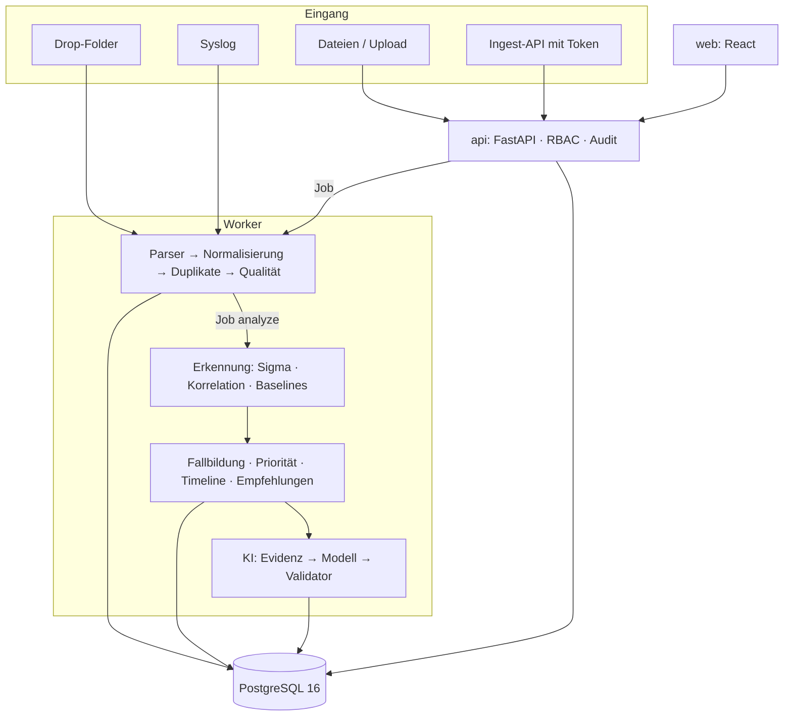

# Architektur

## Komponenten

| Paket (`backend/src/sentinelops/`) | Aufgabe | I/O? |
|---|---|---|
| `parsers/` | Formate lesen, Rohsätze bilden, Windows-Events auf Schema mappen | liest Streams |
| `normalize/` | Schema, Zeit, Identitäten, Fingerprints, Qualität | **nein** |
| `ingest/` | Importläufe, COPY in PostgreSQL, Drop-Folder, Syslog | ja |
| `detection/` | Sigma-Loader (pySigma), Matcher, Korrelation, Baselines, Ausnahmen | Matcher/Korrelation **nein** |
| `correlation/` | Alarme, Fallbildung (Union-Find mit Hub-Unterdrückung), Priorität, Timeline | **nein** |
| `investigation/` | Playbook-Schritte und Empfehlungen | nein |
| `ai/` | Evidenz-Paket, Prompt, Anbieter, Validator, Injection-Erkennung, Pseudonymisierung | Validator **nein** |
| `response/` | Maßnahmen-Zustandsautomat, signierte Freigaben, Simulations-Connector | nein |
| `reports/` | JSON/Markdown/PDF, CSV, Sammelbericht, Pseudonymisierung | Render **nein** |
| `storage/` | Tabellen, Engine, Audit, Queue, Aufbewahrung | ja |
| `worker/` | Jobs ausführen, Analyse persistieren | ja |
| `api/` | Routen, Auth-Abhängigkeiten, Sicherheits-Middleware, SPA-Auslieferung | ja |
| `auth/` | OIDC, Demo-Tokens, Ingest-Tokens, Rollen | ja (JWKS) |

## Architekturregeln (automatisch geprüft)

`import-linter` (`make arch-check`, Konfiguration in `backend/pyproject.toml`):

1. Fachlogik (`normalize`, `detection.matcher`, `detection.correlation`, `correlation`,
   `ai.validator`, `reports.render`, `reports.pseudonymize`) importiert weder SQLAlchemy,
   asyncpg, httpx, FastAPI/Starlette noch `storage`, `api`, `worker`, `ingest.runs`.
2. `api` greift nicht direkt auf `parsers` zu (Quelltyp-Prüfung über `ingest.sources`).
3. `ai` importiert nichts aus `response` – die KI kann keine Maßnahmen auslösen.

Zusätzlich: Jede API-Route braucht einen Eintrag in `api/permissions.yaml`; die App startet sonst
nicht, und ein Test gleicht Routen, OpenAPI und Berechtigungen ab.

## Analyse-Ablauf

1. **Ingestion:** Parser erzeugen Rohsätze und normalisierte Events (Thread-Pool), Batches von
   5.000 werden per `COPY` in temporäre Tabellen geschrieben und mit `ON CONFLICT` übernommen.
   Danach wird ein `analyze`-Job eingereiht (dedupliziert).
2. **Erkennung:** Alle Events werden in Zeitreihenfolge gegen die aktiven Regeln geprüft;
   Korrelationen bilden Alarme als zusammenhängende Bursts; Ausnahmen markieren Treffer.
3. **Fallbildung:** Alarme werden über gemeinsame Entitäten (Benutzer, Host, IP) innerhalb von
   2 h verbunden; Hubs (Domänencontroller, Gateways, automatisch erkannte Vielnutzer-Systeme)
   verbinden nicht. Fall-IDs sind deterministisch; manuell bearbeitete Fälle bleiben stabil.
4. **Priorität:** additiver Score aus Faktoren mit Belegen (Schweregrad, kritisches Asset,
   privilegiertes Konto, Erfolg nach Fehlversuchen, Privilegienänderung, Ausnahmen …), P1–P4.
5. **Zusammenfassung:** Vorlage (immer) und optional KI mit Validierung.

## Determinismus

IDs sind Hashes aus Inhalten (`stable_hash`), Sortierungen sind total, die Zeitquelle ist
injizierbar (`Runtime.clock`; Demo-Modus mit fester Uhrzeit). Gleiche Daten + Konfiguration +
Regeln ⇒ identische Fälle und byte-identische Berichte (A5).

## Laufzeit

Container `api` (Uvicorn, liefert auch die gebaute Web-App aus), `worker`, `db` (PostgreSQL 16),
`keycloak` (OIDC). Konfiguration über Umgebungsvariablen (`.env.example`), siehe
[Betrieb](operations.md).
