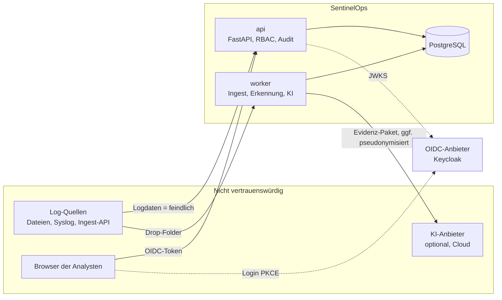

# Bedrohungsmodell (STRIDE)

Stand: 18.10.2026, Version 1.0. Wird bei jeder Architekturänderung aktualisiert
(siehe [Architektur](architecture.md)).

## Systemgrenzen und Vertrauenszonen

**Grundannahme:** Alle Inhalte von Logdaten sind feindlich (CLAUDE.md Regel 5). Angreifer, deren
Aktivität protokolliert wird, können Benutzernamen, Hostnamen, Kommandozeilen und Freitext steuern.

## Assets

| Asset | Schutzziel |
|---|---|
| Rohdaten und Events | Integrität (Beweiswert), Vertraulichkeit (personenbezogen) |
| Fälle, Bewertungen, Notizen | Integrität, Vertraulichkeit |
| Freigaben von Maßnahmen | Integrität, Nichtabstreitbarkeit |
| Audit-Log | Integrität, Nichtabstreitbarkeit |
| Ingest-Tokens, OIDC-Konfiguration, Freigabe-Schlüssel | Vertraulichkeit |
| Verfügbarkeit der Erkennung | Verfügbarkeit |

## Bedrohungen und Gegenmaßnahmen

| # | STRIDE | Bedrohung | Gegenmaßnahme | Nachweis |
|---|---|---|---|---|
| T1 | Spoofing | Fremder ruft API ohne gültige Anmeldung auf | OIDC-JWT-Prüfung (Signatur über JWKS, `iss`, `aud`, `exp`), Rollen aus Token-Claims, Demo-Token nur im Demo-Modus | `tests/unit/test_auth.py`, `tests/integration/test_api_errors.py` |
| T2 | Spoofing | Gefälschte Logs über die Ingest-API | Eigene, widerrufbare Ingest-Tokens (`soi_<id>_<secret>`, nur Hash gespeichert), getrennt von Benutzer-Logins; Quelle und Kanal je Importlauf protokolliert | `test_api.py::test_upload_and_token_ingest`, `test_auth.py::test_ingest_tokens_and_permission_files` |
| T3 | Tampering | Manipulation von Rohdaten nach Import | Rohdaten unveränderlich; Events verweisen auf Rohsatz; Hash je Datei; Event-Hash im Bericht | A3, A5 |
| T4 | Tampering | Nachträgliche Änderung des Audit-Logs | DB-Trigger verbietet UPDATE/DELETE/TRUNCATE; Hash-Kette (`verify_chain`), Prüfung über API | `test_storage.py::test_audit_log_is_append_only_and_chained` |
| T5 | Tampering | Maßnahme mit veränderten Parametern nach Freigabe ausführen | Freigabe signiert Parameter-Hash per HMAC; Ausführung prüft Signatur und Hash | `tests/unit/test_response.py`, A7 |
| T6 | Repudiation | Analyst bestreitet Freigabe/Statusänderung | Audit-Eintrag mit Benutzer, Zeit, Details für Anmeldungen, Fallstatus, Regeln, Ausnahmen, Maßnahmen, Freigaben, Exporte, KI-Aufrufe | Audit-Tests in `test_api.py` |
| T7 | Information Disclosure | XSS über Log-Inhalte (`<script>`, `onerror`, `javascript:`) im Dashboard | React-Textausgabe, kein `dangerouslySetInnerHTML` (Semgrep-Regel), strikte CSP ohne `unsafe-inline` für Skripte, Rohzeilen als `<pre>`-Text | Playwright-XSS-Suite (`e2e/xss.spec.ts`), `.semgrep.yml` |
| T8 | Information Disclosure | Markdown-/CSV-Injection in Berichten (`=HYPERLINK(...)`) | Markdown-Escaping in `finalize`, Rohzeilen in Code-Blöcken mit sicherem Zaun; CSV-Formel-Präfixe neutralisiert | `test_reports.py` |
| T9 | Information Disclosure | Personenbezogene Daten an Cloud-KI | KI standardmäßig aus; Cloud nur mit Opt-in; Pseudonymisierung standardmäßig an; nur Evidenz-Paket statt Datenbankzugriff | `tests/unit/test_ai.py` |
| T10 | Information Disclosure | Rollen sehen mehr als nötig | `permissions.yaml` für jede Route, App startet nicht bei fehlender Route; Auditor nur lesend | `test_api.py::test_every_route_enforces_authentication_and_permissions` |
| T11 | Denial of Service | Riesige oder bösartige Dateien (XML-Bomben, überlange Zeilen, kaputte EVTX) | `defusedxml`, Größen- und Zeilenlimits, Abbruch nach N Fehlern, Quarantäne statt Absturz; Upload-Limits, Rate-Limits | Property-/Fuzz-Tests `tests/property/`, `test_parser_edges.py` |
| T12 | Denial of Service | Event-Flut sprengt Fallbildung (Hub-Hosts) | Hub-Unterdrückung (konfiguriert + automatisch), Zeitfenster, partitionierte Tabellen | Benchmark (100 % Einzelfall-Bündelung) |
| T13 | Elevation of Privilege | **Prompt-Injection** in Logdaten bringt die KI dazu, Maßnahmen auszulösen oder Fakten zu erfinden | KI hat keinen Zugriff auf Maßnahmen (Architekturregel `import-linter`); Daten im Prompt abgegrenzt nach den Anweisungen; Validator verwirft unbelegte Aussagen, Indikatoren und Handlungsbehauptungen; Injection-Erkennung markiert Fall | A6, `test_ai.py`, `lint-imports` |
| T14 | Elevation of Privilege | Analyst gibt eigene Maßnahme frei | Vier-Augen-Prinzip (Standard an): Vorschlagende Person kann nicht freigeben; Freigabe nur Rolle `senior_analyst`/`admin` | `test_response.py`, A7 |
| T15 | Elevation of Privilege | Code-Ausführung über Regeln/Konfiguration | `yaml.safe_load`, kein `pickle`, kein `eval`, keine Shell; Regeln nur aus dem Repository bzw. von `detection_engineer` | `.semgrep.yml`, Ruff `S` |
| T16 | Tampering | CSRF gegen zustandsändernde Routen | Bearer-Token im Header (kein Cookie-Login), Origin-Prüfung für zustandsändernde Methoden | `test_api.py::test_cross_origin_writes_rejected` |
| T17 | Information Disclosure | Geheimnisse im Repository | gitleaks über gesamte Historie (pre-commit + CI), nur synthetische Testwerte | `make security` |
| T18 | Tampering | Lieferkette (manipulierte Abhängigkeiten/Actions) | Lockfiles mit Hashes, `pip-audit`, `pnpm audit`, Dependabot, Actions auf SHA gepinnt, SBOM + cosign-Signatur, OpenSSF Scorecard | `.github/workflows/` |

## Restrisiken

- Ein Angreifer mit Schreibzugriff auf die Datenbank kann das Audit-Log neu aufbauen; die
  Hash-Kette macht das nur gegenüber zuvor exportierten Kopien erkennbar. Empfehlung: regelmäßiger
  Export des Audit-Logs auf WORM-Speicher ([Betrieb](operations.md)).
- Die Erkennung ist so gut wie die Regeln; nicht abgedeckte Techniken erzeugen keine Fälle.
  SentinelOps ersetzt kein SIEM/EDR.
- KI-Zusammenfassungen können trotz Validierung irreführende Formulierungen enthalten; sie sind
  gekennzeichnet und nie Grundlage automatischer Maßnahmen.
- Akzeptierte Abhängigkeitsrisiken: [Akzeptierte Risiken](security/accepted-risks.md).
