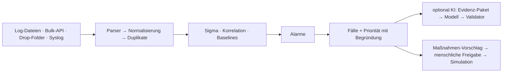

# Rundgang: vom Log zum Fall

Dieser Rundgang zeigt an einem einzigen Beispiel, wie SentinelOps arbeitet: **Szenario 2** der
fiktiven Musterfirma GmbH – ein Brute-Force-Angriff, der erfolgreich ist und mit der Aufnahme des
Kontos in die Domänen-Admins endet. Alle Bilder stammen aus der Demo-Instanz
(`make screenshots`, Seed `dev`, feste Demo-Uhrzeit 12.03.2026, 10:30) und wechseln mit dem
hellen bzw. dunklen Design dieser Seite.

!!! info "Selbst ausprobieren"
    `docker compose -f deploy/docker-compose.yml --env-file .env up -d --build`, dann
    <http://localhost:8080> öffnen und „Demo Senior Analyst (L2)“ wählen – siehe
    [Installation und Betrieb](operations.md).

## 1. Lagebild – was ist los?

Das Lagebild beantwortet die Frage „Muss ich jetzt handeln?“. Jede Zahl nennt ihren Zeitraum und
den Datenstand: Events heute, Alarme der letzten 24 Stunden, offene Fälle nach Priorität und die
mittlere Zeit bis zur Bearbeitung. Darunter folgen der Verlauf von Events und Alarmen, die
häufigsten Regeln und Entitäten und die Gesundheit der Datenquellen.

## 2. Fall-Warteschlange – was zuerst?

SentinelOps zeigt keine Flut einzelner Alarme, sondern **Fälle**: Alarme, die über gemeinsame
Konten, Rechner oder IP-Adressen zusammenhängen, werden gebündelt. Die Priorität ist immer
Farbe **und** Symbol **und** Text (P1 rot/Achteck … P4 grau/Punkt) und damit farbenblindsicher.
Mit `j`/`k` wird navigiert, `a` weist zu, `/` sucht, `?` zeigt alle Tastenkürzel.

## 3. Falldetail – warum P1?

Der Fall bündelt **5 Alarme und 43 Ereignisse** zwischen 03:10:49 und 03:21:17 Uhr. Die Priorität
ist keine Blackbox, sondern eine transparente Summe:

| Punkte | Faktor | Belege |
|---|---|---|
| +70 | höchster Regel-Schweregrad `critical` (SO-PRIV-001, Aufnahme in privilegierte Gruppe) | E42 |
| +15 | erfolgreiche Anmeldung von 203.0.113.45 nach 40 Fehlschlägen | E41, E1, E2 |
| +10 | privilegiertes Konto beteiligt | E42, E43 |
| +10 | kritisches Asset beteiligt (Domänencontroller) | E42, E43 |
| +10 | Rechteänderung im Fall | E42, E43 |
| +15 | vier ATT&CK-Taktiken | E1, E41, E42, E43 |
| **100** | **Summe → P1** (auf 100 begrenzt) | |

Jeder Beleg `E1 … En` ist eine konkrete Rohzeile. Rechts stehen die **empfohlenen nächsten
Schritte** aus den Playbooks der beteiligten Regeln. Prüfschritte sind sofort möglich; Eingriffe
wie „Konto sperren“ sind als *freigabepflichtig* markiert.

Die **Zusammenfassung** trennt Fakten, Hypothesen und fehlende Informationen. Ein Validator
verwirft jede Aussage ohne Beleg, auch erfundene IP-Adressen, Konten oder Hashes. Ohne
KI-Anbieter entsteht eine deterministische Vorlagen-Zusammenfassung; in der Demo ist sie als
„Demo-Simulation (kein echtes Modell)“ gekennzeichnet.

## 4. Timeline – wie lief es ab?

Jede Entität hat eine eigene Spur: Das Konto `jonas.becker`, der Rechner `ATTACKER-PC` und die IP
`203.0.113.45` zeigen die Serie fehlgeschlagener Anmeldungen (Windows-Event 4625), danach die
erfolgreiche Anmeldung; einige Minuten später tauchen auf dem Domänencontroller `DC01` die
Rechteänderungen auf. Rauten markieren die Events, die eine Regel ausgelöst haben. Ein Bereich
lässt sich zum Zoomen aufziehen; die Liste ist virtualisiert und bleibt auch mit 5.000 Events flüssig.

## 5. Belege – stimmt das?

Für jeden Alarm ist die Kette lückenlos nachvollziehbar: **Regel** (Sigma-YAML, die auslösende
Bedingung hervorgehoben) → **passende Felder** (hier `group.name = Domain Admins`) → **normalisiertes
Ereignis** → **Rohzeile** (das Original-XML von Windows-Event 4728). Logdaten werden dabei immer als
Text dargestellt, nie als HTML – auch wenn ein Angreifer Skripte in Benutzernamen versteckt.

Ist ein Alarm ein Fehlalarm, markiert der Analyst ihn mit Begründung und schlägt eine befristete
Ausnahme vor; beides landet im Audit-Log.

## 6. Entitätsgraph – wer hängt mit wem zusammen?

Der Graph zeigt die Beziehungen zwischen Benutzern, Rechnern und IP-Adressen des Falls. Sehr häufig
verbundene Knoten (z. B. ein zentraler Server) werden bei der Fallbildung unterdrückt, damit
nicht alles mit allem verschmilzt.

## 7. Maßnahme freigeben – der Mensch entscheidet

Ein Analyst (L1) schlägt eine Maßnahme vor, ein Senior Analyst (L2) gibt sie mit Begründung frei
oder lehnt sie ab. Optional gilt das Vier-Augen-Prinzip (Vorschlagende dürfen nicht selbst
freigeben). Freigaben sind signiert und werden vor jeder Ausführung erneut geprüft und protokolliert. In Version 1 werden
Maßnahmen ausschließlich **simuliert**. Die KI hat keinen Zugriff auf Maßnahmen.

## 8. Bericht – reproduzierbar dokumentiert

Der Fallbericht steht als Markdown, PDF und JSON bereit, auf Wunsch pseudonymisiert. Gleiche
Daten, Regeln und Konfiguration ergeben **byte-identische** Berichte (Abnahmetest A5); jeder
Export wird protokolliert.

## 9. Regeln und Datenqualität – kann ich dem System trauen?

Die Regelansicht zeigt für jede Regel Treffer, Fehlalarmquote und Reifegrad; das Regeldetail
enthält die positiven und negativen Testfälle. Alle Regeln stehen im
[Erkennungskatalog](detection-catalog.md).

Die Datenqualität zeigt je Importlauf, wie viele Datensätze übernommen, als Duplikat erkannt oder
als fehlerhaft in Quarantäne gelegt wurden – mit Fehlercode. Doppelte Daten ändern keine
Alarm- oder Fallzählung (Abnahmetest A3).

## Wie es unter der Haube funktioniert

Mehr dazu: [Architektur](architecture.md), [Schema](schema.md), [KI-Prinzipien](ai.md) und das
[Benutzerhandbuch](user-guide/index.md).
