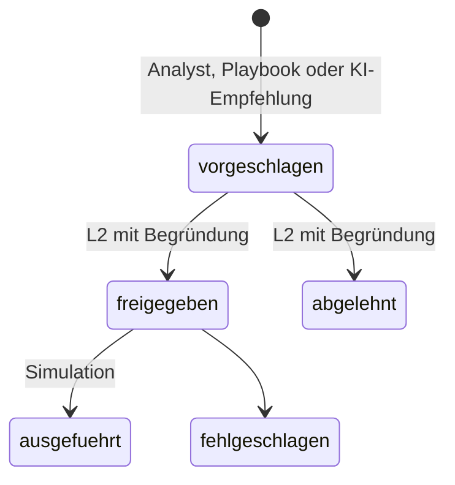

# Maßnahmen und Freigaben

SentinelOps führt **keine** Gegenmaßnahmen automatisch aus. Maßnahmen mit Wirkung (Konto sperren,
Passwort zurücksetzen, Rechner isolieren, Quell-IP sperren) entstehen nur als Vorschlag und brauchen
eine menschliche Freigabe.

## Ablauf

1. **Vorschlagen** – im Fall unter „Empfohlene nächste Schritte“ bei einer freigabepflichtigen
   Maßnahme „Maßnahme vorschlagen“ wählen, Parameter prüfen (z. B. das Konto) und begründen.
2. **Freigeben oder ablehnen** – eine Person mit Rolle **Senior Analyst (L2)** öffnet „Prüfen und
   entscheiden“. Der Dialog zeigt Maßnahme, Parameter, Begründung des Vorschlags und den Hinweis auf
   den Simulationsmodus. Eine Begründung der Entscheidung ist Pflicht.

   

3. **Ausführen** – nach der Freigabe „Ausführen (Simulation)“. In Version 1 protokolliert der
   Simulations-Connector nur, was ein echter Connector tun würde; es wird nichts verändert.

## Absicherung

- **Vier-Augen-Prinzip** (Standard an): Wer vorgeschlagen hat, darf nicht selbst freigeben.
- Die Freigabe wird über Maßnahme und **Parameter-Hash signiert** (HMAC). Ändern sich die Parameter
  nachträglich oder fehlt eine gültige Freigabe, verweigert die Ausführung – auch über die API.
- Jede Statusänderung und jede verweigerte Ausführung steht im Audit-Log.
- Die KI kann Maßnahmen weder vorschlagen noch auslösen; Aussagen wie „Konto wurde gesperrt“ ohne
  tatsächliche Ausführung verwirft der Validator.

Abnahmetest A7 prüft das über API und Oberfläche (`e2e/a7_approval.spec.ts`).
