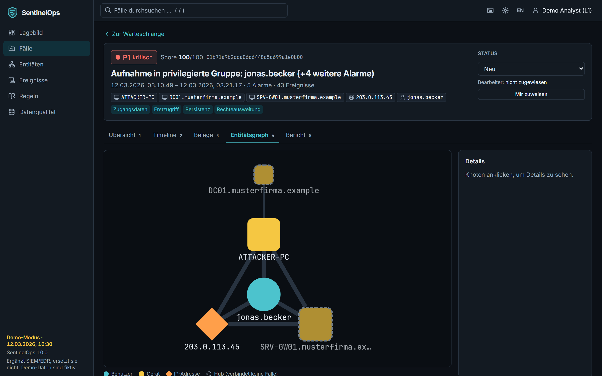

# Lagebild und Fälle

## Lagebild

Das Lagebild zeigt Events des heutigen Tages, Alarme der letzten 24 Stunden, offene Fälle nach
Priorität (ein Klick filtert die Warteschlange) und die mittlere Zeit bis zur ersten Bearbeitung.
Darunter: Verlauf von Events und Alarmen (24 h / 7 Tage), häufigste Regeln, häufigste Entitäten in
offenen Fällen und der Zustand der Ingestion je Quelle. Der Hinweis „Baseline im Aufbau“ nennt
Benutzer, für die noch zu wenig Historie für ungewöhnliche Anmeldungen vorliegt – für sie entsteht
bewusst kein Alarm.

## Fall-Warteschlange

Fälle sind nach Priorität, Score und Aktualität sortiert. Filter für Priorität und Status sowie die
Suche stehen in der Adresszeile (Links lassen sich teilen). Pro Fall sehen Sie die beteiligten
Entitäten, ausgelösten Regeln, ATT&CK-Taktiken, das Alter seit der ersten Aktivität, Bearbeiter und
Status. Markierungen weisen auf Prompt-Injection-Inhalte und Bezüge zu anderen Fällen hin.

Massenaktionen (mit `x` auswählen): „Mir zuweisen“, „In Bearbeitung setzen“.

## Falldetail – Übersicht

- **Priorität mit Begründung:** Jeder Faktor mit Beitrag und Belegen (E-Nummern verlinken auf den
  Beleg). Die Summe ergibt den Score 0–100 und damit P1–P4.
- **Zusammenfassung:** bestätigte Fakten (mit Belegen), Hypothesen (gestrichelt, mit Konfidenz und
  „würde bestätigt durch“), fehlende Informationen. Die Kennzeichnung zeigt, ob der Text aus der
  Vorlage, von einer KI oder vom Demo-Simulator stammt; verworfene KI-Aussagen sind einsehbar.
- **Empfohlene nächste Schritte** aus dem Playbook-Katalog mit Begründung; Maßnahmen lassen sich
  direkt vorschlagen (siehe [Maßnahmen](actions.md)).
- **Status und Bearbeiter** rechts oben; jede Änderung landet im Audit-Log.

## Timeline

Oben die Spuren je Entität (Benutzer, Gerät, IP): Striche sind Events, hervorgehobene Striche
auslösende Events, Rauten Alarme. Ziehen Sie mit der Maus einen Bereich auf, um hineinzuzoomen.
Darunter die vollständige chronologische Liste mit Zeitlücken und Zeitqualitätshinweisen
(angenommene Zeitzone, abgeleitetes Jahr, Uhrzeitversatz); Filter nach Spur und „nur auslösende
Events“.

## Entitätsgraph

Der Graph zeigt, welche Benutzer sich von welchen Adressen an welchen Geräten angemeldet haben.
Hubs (z. B. Domänencontroller) sind gestrichelt – sie verbinden keine Fälle miteinander. Ein Klick auf
einen Knoten zeigt Details und führt zu allen Fällen mit dieser Entität.

## Ereignisse und Entitäten

Die Seite **Ereignisse** durchsucht alle normalisierten Events nach Volltext, Benutzer, Gerät,
IP-Adresse, Aktion und Bewertung und exportiert das Ergebnis als CSV (gegen Formel-Injection
geschützt). **Entitäten** listet Benutzer, Geräte und Adressen mit Merkmalen (privilegiert,
kritisches Asset, Hub) als Ausgangspunkt für Pivot-Analysen.
