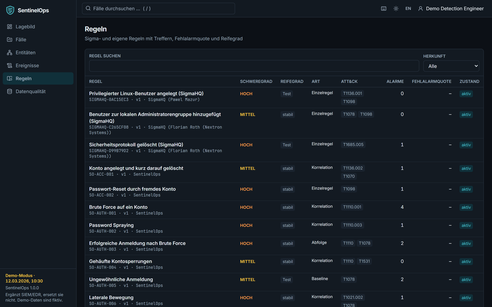

# Regeln, Datenqualität, Administration

## Regeln

Die Regelliste zeigt alle Regeln mit Schweregrad, Reifegrad, Art (Einzelregel, Korrelation, Abfolge,
Baseline), ATT&CK-Techniken, Anzahl Alarme, Fehlalarmquote und Zustand. Das Regeldetail enthält
Beschreibung, Herkunft (SentinelOps oder SigmaHQ mit Autor und Lizenz), Regelquelle, Regeltests,
Versionen, letzte Alarme und Ausnahmen. Detection Engineers können Regeln mit Begründung aktivieren
oder deaktivieren; L2 genehmigt vorgeschlagene Ausnahmen. Neue Regeln entstehen im Repository mit
Tests (siehe CONTRIBUTING.md) – nicht in der Oberfläche.

## Datenqualität

Jeder importierte Datensatz endet in genau einer Kategorie: **übernommen**, **Duplikat** oder
**fehlerhaft**. Die Seite zeigt die Anteile je Quelle, Fehlercodes (`PARSE_ERROR`, `MISSING_TIMESTAMP`,
`INVALID_ENCODING`, `SCHEMA_VIOLATION`, `TRUNCATED`, `OVERSIZED`), alle Importläufe und die
**Quarantäne** mit Rohinhalt, Fehlercode und Position. Nach Korrektur eines Mapping-Profils lassen
sich fehlerhafte Datensätze eines Laufs neu verarbeiten. Administratoren können hier Dateien
hochladen (Quelltyp und Zeitzone wählen).

## Administration

- **Ingest-Tokens** für die Bulk-API anlegen und widerrufen (das Token wird nur einmal angezeigt).
- **Datenquellen** als Vorlagen (Name, Quelltyp, Zeitzone) pflegen.
- **Benutzer** sehen (Rollen kommen aus dem Identitätsanbieter).
- **Wirksame Einstellungen** ohne Geheimnisse einsehen; geändert wird über Umgebungsvariablen
  ([Betrieb](../operations.md)).
- **Analyse jetzt starten** reiht einen Analyse-Job ein.

## Audit-Log

Auditoren sehen alle sicherheitsrelevanten Aktionen (Anmeldungen, Fallstatus, Regeländerungen,
Ausnahmen, Maßnahmen, Freigaben, Exporte, KI-Aufrufe, Aufbewahrung). „Hash-Kette prüfen“ bestätigt,
dass kein Eintrag verändert wurde.
