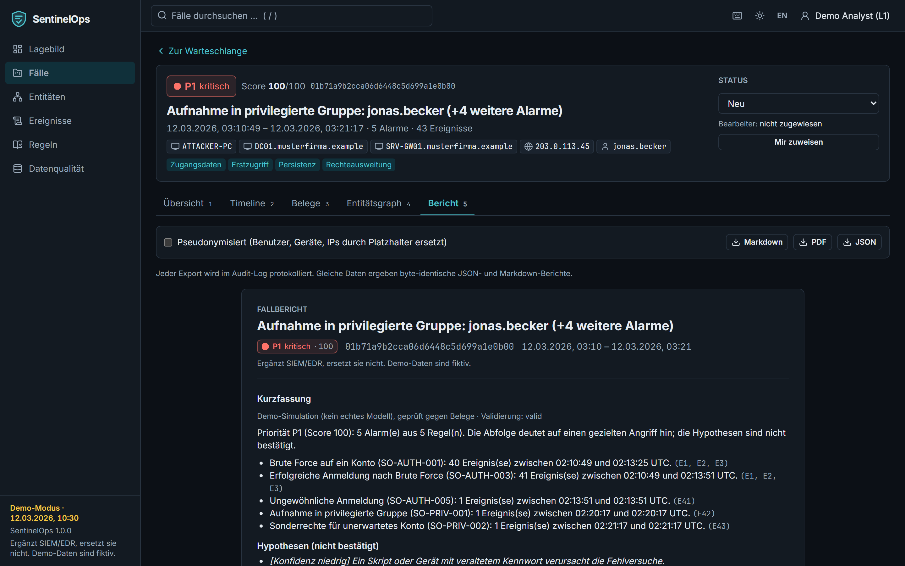

# Berichte

Der Bereich **Bericht** zeigt eine Vorschau des Fallberichts und exportiert ihn als **Markdown**,
**PDF** oder **JSON**. Inhalt: Kurzfassung (mit Kennzeichnung und Validierungsstatus), Priorität mit
Begründung, Alarme mit Regel-ID und -Version, Regeln mit Herkunft und Lizenz, empfohlene Schritte,
Maßnahmen und Freigaben, Timeline, Belegauszüge, Analystennotizen und Metadaten.

- **Reproduzierbar:** Gleiche Daten, Regeln und Konfiguration ergeben byte-identische JSON- und
  Markdown-Berichte und eine PDF mit identischem Text (Abnahmetest A5). Die Metadaten enthalten
  Hashes der Events, des Regelsatzes und der Konfiguration, Softwareversion und Prompt-Version.
- **Pseudonymisiert:** Mit der Option „Pseudonymisiert“ werden Benutzer, Geräte und IP-Adressen durch
  Platzhalter (`USER_1`, `HOST_1`, `IP_1`) ersetzt – auch in Rohzeilen.
- **Protokolliert:** Jeder Export erzeugt einen Audit-Eintrag (Format, SHA-256, Pseudonymisierung);
  die Vorschau selbst ist kein Export.

Der **Sammelbericht** (`GET /api/v1/reports/aggregate`, JSON oder CSV) fasst einen Zeitraum zusammen:
Fälle nach Priorität und Status, häufigste Regeln, Fehlalarmquoten, Bearbeitungszeiten.
